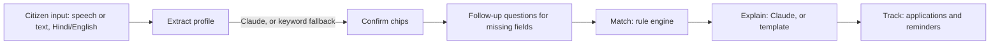

# Sahayak Architecture

## Flow

## API

| Method | Path | Request | Response |
|---|---|---|---|
| POST | /api/profile/extract | {text, lang} | {profile, missing_fields, source} |
| POST | /api/match | {profile} | {matches} |
| POST | /api/explain | {scheme_id, rule_results, lang} | {text} |
| GET | /api/schemes/[id] | - | scheme detail |
| GET / POST / PUT | /api/admin/schemes | scheme data (auth) | scheme data |
| GET | /api/admin/reports | - (auth) | report data |
| POST / GET / PUT | /api/applications | application data | application data |
| POST | /api/report | anonymous report | ack |
| GET | /api/impact | - | impact figures |
| POST | /api/admin/login | credentials | session |
| POST | /api/admin/logout | - | ack |

## Where the LLM is used

- **Language understanding** in extraction: turning free Hindi or English speech into structured profile fields.
- **Simple wording** in explanation: rewriting rule results as plain sentences.

If Claude is unavailable or its output fails validation, a keyword extractor and a template explainer are used instead.

## Where the LLM is NOT used

- Eligibility decisions (the rule engine decides).
- Amounts.
- Rules and thresholds.
- Documents list.
- Application steps.
