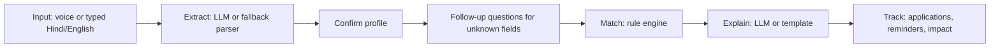

# Architecture

## Flow

- **Extract**: turns the sentence into a Profile. Uses the LLM if `LLM_API_KEY` is set; otherwise a local fallback parser.
- **Confirm**: user checks the extracted profile.
- **Follow-up**: asks for fields still missing.
- **Match**: rule engine checks each scheme's rules and returns `met`, `not_met` or `unknown` per rule.
- **Explain**: writes plain Hindi/English reasons. Uses LLM if available, else a template.
- **Track**: saves applications, creates reminders, and feeds the impact dashboard.

## API

| Method | Path | Purpose |
|---|---|---|
| POST | `/api/profile/extract` | Extract profile fields from text (rate limited) |
| POST | `/api/match` | Run rule engine on a profile |
| POST | `/api/explain` | Explain results in simple wording (rate limited) |
| GET | `/api/schemes/[id]` | One scheme with rules, documents, steps |
| POST | `/api/family` | Run engine for each family member |
| POST | `/api/admin/login` | Admin login |
| POST | `/api/admin/logout` | Admin logout |
| GET | `/api/admin/schemes` | List schemes (auth) |
| POST | `/api/admin/schemes` | Create scheme (auth) |
| PUT | `/api/admin/schemes` | Update scheme and rules (auth) |
| DELETE | `/api/admin/schemes` | Delete scheme (auth) |
| GET | `/api/reports` | List reports (auth) |
| POST | `/api/reports` | Submit a report |
| GET | `/api/applications` | List tracked applications |
| POST | `/api/applications` | Add tracked application |
| PUT | `/api/applications` | Update tracked application |
| GET | `/api/impact` | Impact dashboard numbers (SAMPLE) |

Auth = admin session cookie from `/api/admin/login`.

## Where the LLM is used

- **Language understanding** in extraction: reading mixed Hindi/English sentences into profile fields.
- **Simple wording** in explanation: turning rule results into short plain sentences.

If the LLM is missing, slow, or its output fails validation, the local parser or template is used.

## Where it is NOT used

- **Eligibility**: the rule engine decides met / not_met / unknown.
- **Rules**: scheme rules come from the database, edited at `/admin`.
- **Amounts**: not generated by LLM; only shown from stored data.
- **Documents**: taken from scheme data.
- **Steps**: taken from scheme data.
